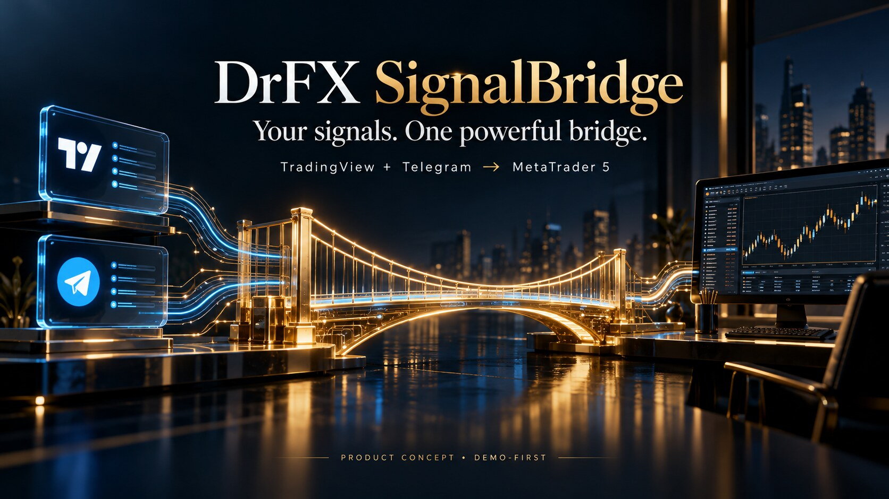
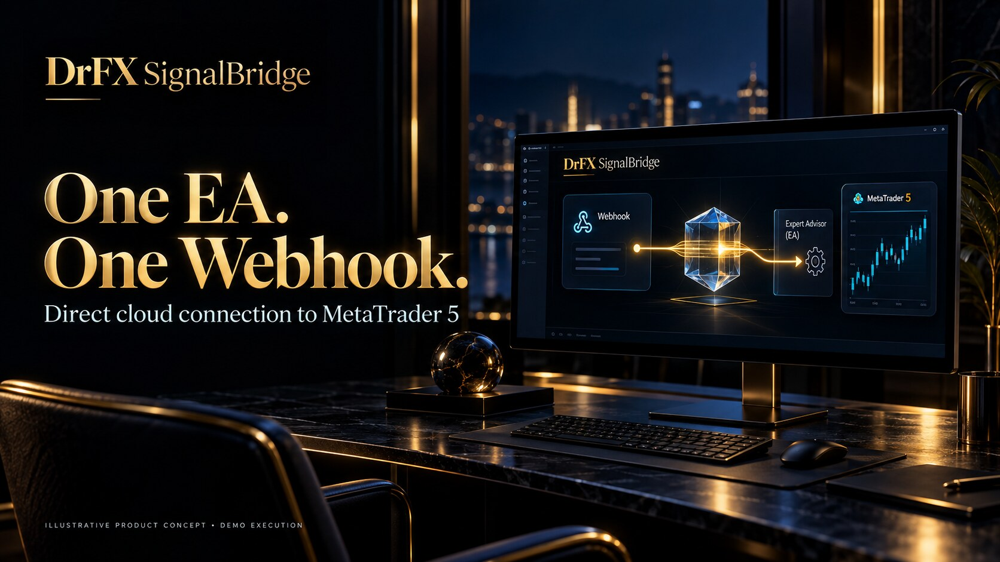
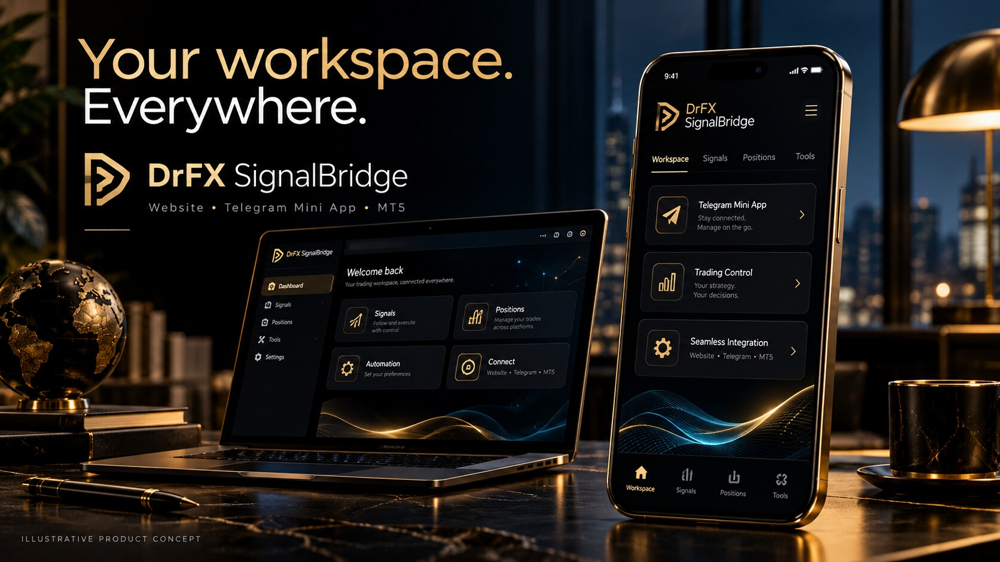
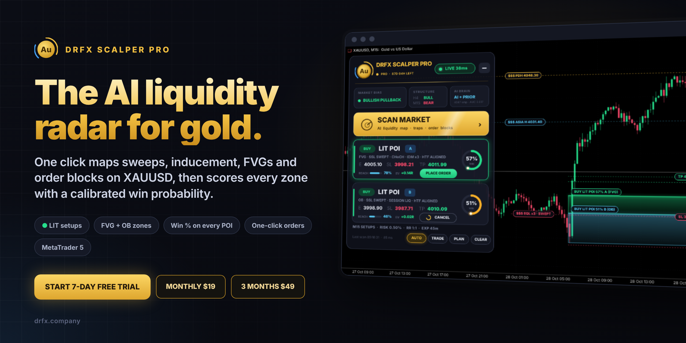
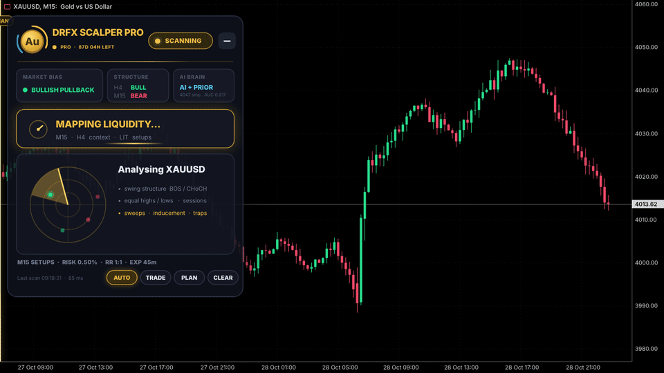

<div align="center">

# ⚡ DrFX SignalBridge

### TradingView + Telegram → MetaTrader 5

**Commercial source-available software · DEMO-only automatic signals; separately opted-in DEMO/LIVE connection tests.**
The public repository is not an open-source license grant. Read [LICENSE](LICENSE),
[SECURITY.md](SECURITY.md) and the [Public Release Checklist](docs/PUBLIC_RELEASE_CHECKLIST.md).



### Product Gallery

These original promotional images are **illustrative product concepts**, not
screenshots or verified evidence of trading performance.

| Direct MT5 connection | Website & Telegram workspace |
|:--:|:--:|
|  |  |

**Languages:** English · فارسی · العربية · Türkçe · Русский · हिन्दी.
Language selection is available on the website, Telegram Mini App and in bot
messages. Persian and Arabic use right-to-left layout.

**One licensed EA. One personal TradingView webhook. DEMO-first routing.**

[](#-install-in-3-steps)
[](#-simple-pricing)
[](#architecture)
[](#safety)

[**Live Dashboard**](https://signalbridge.drfx.online/dashboard) · [**V3 Design Preview**](https://signalbridge.drfx.online/experience/) · [**Test Panel**](https://signalbridge.drfx.online/test) · [**Download ZIP**](https://github.com/drfxai/Signal-Bridge/archive/refs/heads/main.zip)

</div>

SignalBridge is a premium realtime bridge for traders who want **TradingView and Telegram signals delivered into MetaTrader 5 with minimal setup**. The V3 architecture removes the Windows companion Agent from the standard user flow: the MT5 EA connects directly to SignalBridge Cloud over TLS/WebSocket.

## 🆕 DrFX Scalper Pro, now in the suite

<p align="center"><a href="products/scalper-pro/README.md"></a></p>

**SignalBridge executes the signals you already trust. Scalper Pro finds new ones on gold.** It is an MT5 Expert Advisor that maps the liquidity sweep, marks the Fair Value Gap and Order Block smart money left behind, and scores every setup with a calibrated win %, reach % and EV before you take it.

- **7-day free trial** inside the EA, then **$19 / 30 days** or **$49 / 90 days**.
- **Buy and get your key in the Client Portal** at [drfx.company](https://drfx.company/#scalper): enter your MT5 account number, pay with crypto, and the key appears in the portal's **Scalper Pro** tab and in the DrFX Telegram bot (`/scalper`).
- **Telegram Mini App:** a Scalper Pro tab shows the promo, plans, install steps and your keys.

<p align="center"></p>

▶ [Promo video](products/scalper-pro/scalper-pro-promo.mp4) · 📘 [Install and user guide](products/scalper-pro/README.md) · 🛠 [Operator setup](site/README.md#scalper-pro)

## ✨ Product direction

- **One MT5 EA** — no Node.js, no PowerShell, no local Windows Agent.
- **One TradingView webhook** — paste it into the Alert and the route is ready.
- **Telegram Bot Connector** — paired signal sources feed the same risk pipeline.
- **Telegram Web App** — mobile-first monitoring and route controls.
- **Telegram Account Connector (MTProto)** — visible as **Coming Soon**, intentionally inactive.
- **Desktop / Tablet / Mobile UI** — one premium responsive design system.
- **Realtime execution visibility** — route state, MT5 state, cloud RTT and broker receipts.
- **Fail-closed safety** — invalid or ambiguous signals do not silently become orders.

## 💎 Simple pricing

| Plan | Price | Access |
| --- | ---: | --- |
| **Free Trial** | **$0 for 1 month** | Full product trial |
| **3 Months** | **$47** | Full SignalBridge access |
| **1 Year** | **$165** | Best annual value |

No monthly paid plan is currently defined. New users start with **one full month free**.

## 🚀 Install in 3 steps

### 1. Install the EA

Open MetaTrader 5 → **File → Open Data Folder** and place:

```text
DrFX_SignalBridge_EA.ex5
```

inside:

```text
MQL5\Experts
```

For source/beta testing, the canonical source is:

```text
mt5/DrFX_SignalBridge_EA.mq5
```

Current direct-cloud source: **EA v0.29.0**. Only the latest EA source is kept in
`mt5/`; earlier versions are available through Git history.

See [EA setup and version details](mt5/README.md) and
[connection test / license controls](docs/EA_V026_CONNECTION_CONTROLS.md).

### 2. Enter your SignalBridge Key

Attach the EA to an MT5 chart and paste your private **SignalBridge Key** into the EA inputs.

MT5 requires the destination to be allowed once in:

**Tools → Options → Expert Advisors**

Add:

```text
https://signalbridge.drfx.online
```

The EA then connects directly to:

```text
wss://signalbridge.drfx.online/v1/ea/ws
```

### 3. Paste one TradingView webhook

Create a TradingView Alert and paste your private SignalBridge webhook:

```text
https://signalbridge.drfx.online/v1/ingress/tradingview/<YOUR_PRIVATE_CONNECTION_TOKEN>
```


That is the standard installation flow.

**No Node.js. No PowerShell. No Windows Agent.**

## ✈️ Telegram

### Telegram Bot Connector — Available

Pair an approved bot/chat/channel and route deterministic trade messages into the same command pipeline used by TradingView.

Example:

```text
XAUUSD BUY
LOT 0.01
SL 2700
TP1 2720
TP2 2730
TP3 2740
```

The parser currently supports deterministic formats in **English, فارسی and العربية**.

### 🆕 TradingView → Telegram channel (no MT5)

Post TradingView alerts straight to your own Telegram channel or group:

1. **Add the bot as an admin** with *Post messages* (Mini App → **Channels**, or the bot's `/channels` buttons).
2. **Pick the chat.** The bot lists every channel and group it was added to by you.
3. **Copy the unique webhook** (`https://drfx.company/tv/ch/<token>`) into the TradingView alert's *Webhook URL*.

Each chat gets its own private link (rotate or delete it any time). Alerts can be JSON
(`symbol`, `side`, `entry`, `sl`, `tp1`–`tp3`, `lot`, `timeframe`, `strategy`, `message`) or plain text,
and are posted with 🟢/🔴 icons, entry, SL and TPs. This route never creates MT5 commands.

Deploy: apply `site/migrations/0015_channel_webhooks.sql`, then re-run
`scripts/configure-company-telegram-bot.mjs` so the bot receives `my_chat_member` updates and shows `/channels`.

### Signal source everywhere

The member dashboard and the EA panel show where each signal came from (TradingView or Telegram),
and every MT5 position opened by the bridge carries it in its comment, e.g. `SB:1a2b3c4d5e6f:TradingView`.

### Telegram Web App — Product UI

Prototype:

```text
design/telegram-webapp.html
```

Bot UX prototype:

```text
design/telegram-bot-flow.html
```

### Telegram Account Connector (MTProto) — Coming Soon

The option is visible in the UI but intentionally inactive. The current release does **not** request or store Telegram phone numbers, API ID/Hash or personal-account sessions.

## 🖥️ Responsive product UI

> The [V3 Design Preview](https://signalbridge.drfx.online/experience/) and Telegram prototypes use **illustrative sample telemetry**; they are not live account dashboards. Real broker state is shown on the authenticated [Live Dashboard](https://signalbridge.drfx.online/dashboard). Subscription checkout and automatic trial activation are not implemented yet.


The V3 product concept is in:

```text
design/index.html
design/styles.css
design/app.js
```

It includes:

- luxury desktop command center;
- tablet layout;
- mobile bottom-navigation experience;
- animated signal-flow visualization;
- MT5 EA panel concept;
- Telegram Bot and Web App experience;
- pricing and install flow.

Run locally:

```bash
npm run dev
```

Then open:

```text
http://localhost:4173
```

## Architecture

```text
TradingView Webhook ─┐
                     ├─→ Cloudflare Worker + D1
Telegram Bot ────────┘          ↓
                         Durable Object Hub
                              ⇅
                    direct TLS/WebSocket
                              ⇅
                       MetaTrader 5 EA
                              ↓
                         Broker DEMO
```

The legacy Windows Agent remains in the repository only as a rollback/reference path. It is **not part of the standard V3 installation experience**.

## Safety

The current EA remains conservative by default:

- DEMO execution only;
- live-account execution blocked;
- broker-side SL;
- spread / lot / price-deviation checks;
- persistent pending-command correlation;
- duplicate/replay protection;
- broker-history reconciliation before blind retry.

The current EA is compiled by the [official Windows MetaEditor workflow](https://github.com/drfxai/Signal-Bridge/actions/workflows/build-ea.yml).
Actual DEMO broker E2E certification remains a release gate.

## UI previews

- Main responsive UI: `design/index.html`
- Telegram Web App: `design/telegram-webapp.html`
- Telegram Bot UX: `design/telegram-bot-flow.html`
- MT5 command-center reference: `design/mt5-command-center.html`

## Repository map

| Path | Purpose |
| --- | --- |
| [`mt5/`](mt5/) | Single current EA source and installation guide |
| [`site/`](site/) | Website, member/admin portals and Telegram Mini App |
| [`worker/`](worker/) | Signal ingress, licensing, realtime delivery and database migrations |
| [`tests/`](tests/) | Regression and integration coverage for the current implementation |
| [`scripts/`](scripts/) | Development, provisioning and verification tools |
| [`design/`](design/) | Active product design previews and approved references |
| [`assets/readme/`](assets/readme/) | Repository-hosted promotional images and setup artwork |
| [`docs/`](docs/) | Architecture, security and deployment guidance |

Historical EA snapshots are recovered from Git history instead of duplicated in the working tree.

## Documentation

- [Architecture](docs/ARCHITECTURE.md)
- [MT5 execution & safety](docs/MT5_EXECUTION.md)
- [Telegram connector](docs/TELEGRAM_CONNECTOR.md)
- [Security & risk](docs/SECURITY_RISK.md)
- [Business model](docs/BUSINESS_MODEL.md)

---

<div align="center">

**DrFX SignalBridge** · Premium realtime routing for TradingView, Telegram and MT5.

**1 month free · 3 months $47 · 1 year $165**

</div>

Latest redesign: [EA 0.27.0 compact panel and controlled DEMO/LIVE tests](docs/EA_V027_LUXURY_TESTS.md).

Test repair: [EA 0.27.1 broker-symbol detection and reliable test checks](docs/EA_V0271_TEST_REPAIR.md).

Current risk controls: [EA 0.28.0 daily drawdown and configurable tests](docs/EA_V028_DAILY_DRAWDOWN.md).

Approved command center: [EA 0.29.0 target policies, reports and Telegram routing](docs/EA_V029_APPROVED_COMMAND_CENTER.md).
