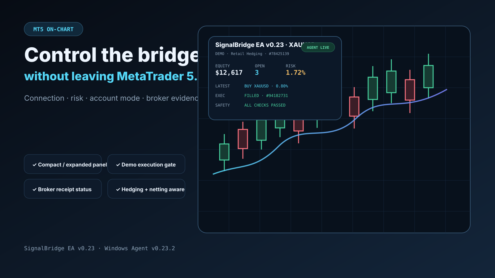
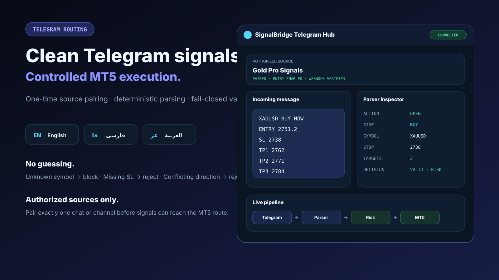

<div align="center">

# DrFX SignalBridge

### TradingView + Telegram → MetaTrader 5

**Fast signal routing. Clear execution status. Broker-side safety.**

[](https://signalbridge.drfx.online/dashboard)
[](#-install-in-4-steps)
[](#-install-in-4-steps)
[](#how-it-works)

[**Open Live Dashboard**](https://signalbridge.drfx.online/dashboard) · [**Open Test Panel**](https://signalbridge.drfx.online/test) · [**Download ZIP**](https://github.com/drfxai/Signal-Bridge/archive/refs/heads/main.zip)

</div>


SignalBridge connects **TradingView**, **Telegram** and **MetaTrader 5** through a persistent Cloudflare WebSocket path and a lightweight Windows Agent. The current public testing boundary is intentionally conservative: **real/live MT5 accounts are blocked by the EA; start with a DEMO account.**

## Why SignalBridge?

| ⚡ Fast path | 🛡️ Safer execution | 🔁 Replay-safe | 👁️ Live visibility |
| --- | --- | --- | --- |
| Persistent WebSocket transport instead of fast HTTP polling. | Broker-side SL, spread/lot checks and DEMO gate inside MT5. | Durable commands, duplicate protection and receipt reconciliation. | Live dashboard, Agent/MT5 state, Cloud RTT and broker receipts. |

<table>
<tr>
<td width="50%"></td>
<td width="50%"></td>
</tr>
</table>

## 🚀 Install in 4 steps


### 1. Download

Use **Code → Download ZIP**, or download the current main branch:

**[Download SignalBridge ZIP](https://github.com/drfxai/Signal-Bridge/archive/refs/heads/main.zip)**

Extract it anywhere on your Windows PC.

### 2. Install the Windows Agent

Install **Node.js 22+** first, then open PowerShell inside the extracted repository and run:

```powershell
powershell -ExecutionPolicy Bypass -File .\install\Install-SignalBridge.ps1
```

The installer:

- creates `%LOCALAPPDATA%\DrFX\SignalBridge`;
- installs the Windows Agent and durable receipt outbox;
- creates `config.json`;
- copies the current MT5 EA to detected MetaTrader 5 data folders;
- creates `Start-SignalBridge-Agent.cmd`.

Open this local file and paste your **private Agent token**:

```text
%LOCALAPPDATA%\DrFX\SignalBridge\config.json
```

> Never commit `config.json`, bot tokens, webhook secrets or Agent tokens to GitHub.

### 3. Compile and attach the MT5 EA

In MetaTrader 5:

1. Open **MetaEditor**.
2. Find **Experts → SignalBridge → DrFX_SignalBridge_EA.mq5**.
3. Compile it.
4. Return to MT5 and attach the EA to a chart.
5. Enable **Algo Trading**.
6. Use an **MT5 DEMO account**.
7. Keep `InpEnableDemoExecution = false` for preview-only tests; enable it only when you intentionally want a real **DEMO** order.

Then start:

```text
%LOCALAPPDATA%\DrFX\SignalBridge\Start-SignalBridge-Agent.cmd
```

When everything is connected, the EA panel should show the local Agent as online.

### 4. Connect a signal source and test

Choose either TradingView or Telegram, then use the built-in test page before sending real DEMO orders.

**[Open SignalBridge Test Panel](https://signalbridge.drfx.online/test)**

Start with **Preview only**. After that passes, switch to **Open on DEMO**.

---

## 📈 TradingView → MT5

Use the private webhook URL issued for your SignalBridge connection:

```text
https://signalbridge.drfx.online/v1/ingress/tradingview/<YOUR_PRIVATE_CONNECTION_TOKEN>
```

For **GOD MODE**, create a TradingView alert with:

- **Condition:** `Any alert() function call`
- **Webhook URL:** your private SignalBridge webhook URL

SignalBridge receives the `[[DRFX]] ... [[/DRFX]]` lifecycle emitted by the script and correlates ENTRY, TP1, TP2, TP3, SL and CLOSE events.

For custom JSON integrations, see [API Contract](docs/API_CONTRACT.md).

## ✈️ Telegram → MT5

Run the included setup script:

```powershell
.\telegram\SignalBridge-Telegram-Setup.ps1 `
  -BotToken "<BOT_TOKEN>" `
  -ConnectionId "<CONNECTION_ID>" `
  -WebhookSecret "<WEBHOOK_SECRET>" `
  -PairCode "<PAIR_CODE>"
```

Then, from the exact Telegram chat or channel you want to authorize:

```text
/signalbridge_pair <PAIR_CODE>
```

After pairing, a strict signal can look like:

```text
XAUUSD BUY
LOT 0.01
SL 2700
TP1 2720
TP2 2730
TP3 2740
```

The production parser supports **English, فارسی and العربية** for the supported deterministic format. Missing or conflicting fields are rejected instead of guessed.

## 🖥️ Live Dashboard

Open:

**https://signalbridge.drfx.online/dashboard**

Enter your private Agent token to see:

- Agent online/offline;
- MT5 terminal online/offline;
- account identity and mode;
- balance, equity and open-position count;
- measured Agent ↔ Cloudflare RTT;
- recent commands and broker receipts;
- integrated Preview / DEMO test control.

## How it works

```text
TradingView / Telegram
        ↓
Cloudflare Worker + D1
        ↓
Durable Object Agent Hub
        ⇅  persistent WebSocket
Windows SignalBridge Agent
        ⇅  localhost TCP
MetaTrader 5 EA
        ↓
Broker DEMO
```

The execution path is designed to **fail closed**. An online Windows Agent does not automatically mean MT5 is ready; replay begins only after the terminal reports a verified account state. Broker receipts are persisted by the Agent before the EA clears unresolved local state.

## Current beta status

✅ TradingView → MT5 DEMO pipeline  
✅ Telegram → MT5 DEMO pipeline  
✅ English / Persian / Arabic Telegram parsing  
✅ Hedging + retail-netting aware MT5 management  
✅ Persistent receipt outbox and reconnect reconciliation  
✅ Live backend-backed dashboard  
✅ Cloudflare custom domain + rate protection  
🔒 Live-account execution intentionally disabled  
🧪 Real MetaEditor/broker certification still required before a public live-money release

<details>
<summary><strong>راهنمای خیلی سریع فارسی</strong></summary>

1. ریپازیتوری را با **Download ZIP** دانلود و Extract کنید.  
2. **Node.js 22+** را نصب کنید و فایل `install\Install-SignalBridge.ps1` را با PowerShell اجرا کنید.  
3. توکن خصوصی Agent را داخل `%LOCALAPPDATA%\DrFX\SignalBridge\config.json` قرار دهید.  
4. فایل `DrFX_SignalBridge_EA.mq5` را در MetaEditor کامپایل و روی یک حساب **DEMO** به چارت اضافه کنید.  
5. `Start-SignalBridge-Agent.cmd` را اجرا کنید.  
6. ابتدا از صفحه **/test** حالت Preview را تست کنید و فقط بعد از موفقیت، اجرای DEMO را فعال کنید.  
7. برای TradingView، Webhook خصوصی را در Alert قرار دهید. برای Telegram، اسکریپت Setup را اجرا و چت موردنظر را با `/signalbridge_pair` Pair کنید.

</details>

## Documentation

- [MT5 execution & safety](docs/MT5_EXECUTION.md)
- [Telegram connector](docs/TELEGRAM_CONNECTOR.md)
- [Architecture](docs/ARCHITECTURE.md)
- [Cloudflare deployment](docs/CLOUDFLARE_DEPLOYMENT.md)
- [Security & risk model](docs/SECURITY_RISK.md)
- [Roadmap](docs/ROADMAP.md)

---

<div align="center">

**DrFX SignalBridge** · Realtime routing with explicit safety boundaries.

Current EA: **v0.23** · Windows Agent: **v0.23.2**

</div>
