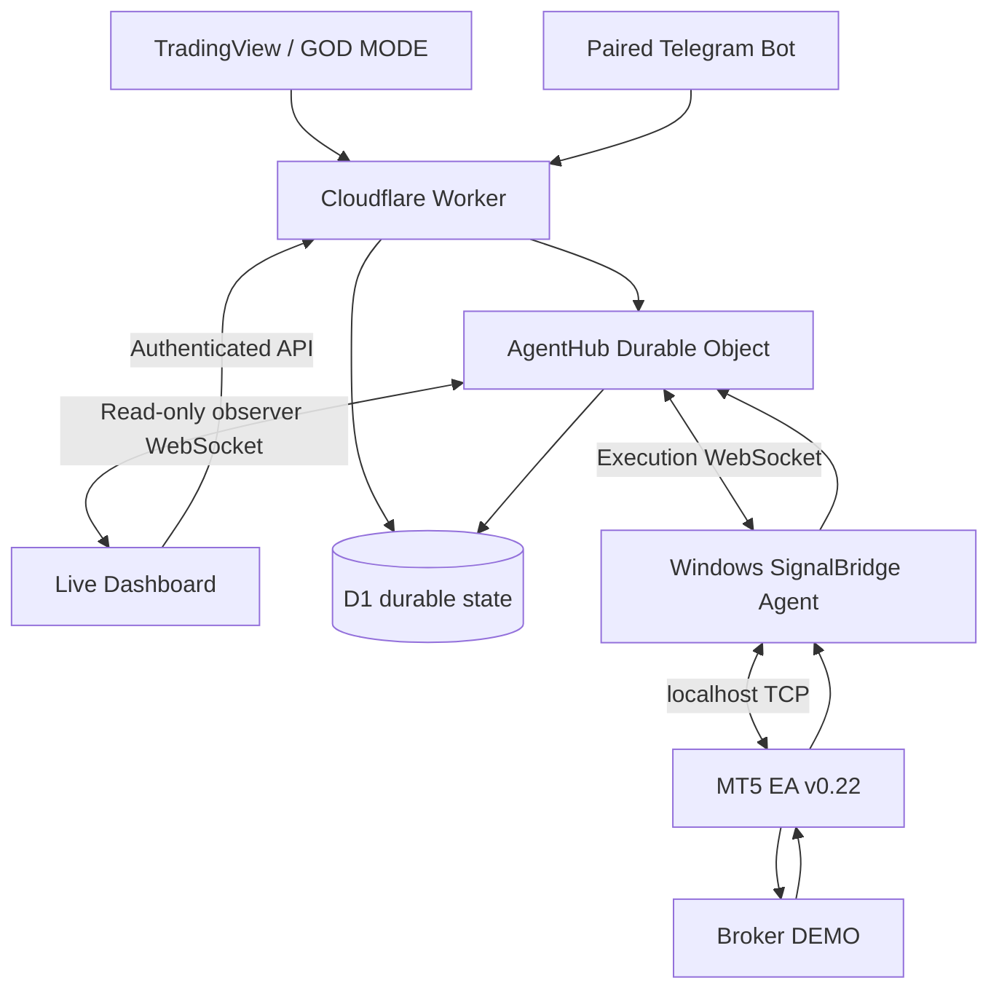

# SignalBridge — Technical Architecture
Version 0.3 · Free-first realtime DEMO beta · 2026-10-28

## Current deployment

SignalBridge is deployed on **Cloudflare Free** using:

- Worker: `drfx-signalbridge-ingress`
- Production custom domain: `signalbridge.drfx.online`
- D1: `signalbridge-ingress`
- account-scoped Durable Object: `AgentHub`
- Windows SignalBridge Agent
- MT5 EA v0.22

The current execution boundary is **DEMO accounts only**.

## Realtime data flow

## Why the dashboard is not static

Static HTML/CSS assets may be cacheable, but **dashboard state is live**. Account state, terminal availability, command history and broker receipts come from D1/AgentHub. The dashboard opens a separate read-only observer WebSocket so UI updates do not supersede the Windows execution Agent. No high-frequency polling is required.

## Ingress reliability

1. Authenticate the source.
2. Parse and validate fail-closed.
3. Persist source event before acknowledging acceptance.
4. Create an idempotent durable command.
5. Attempt realtime dispatch only when the Agent socket and MT5 terminal state are both online.
6. Keep undelivered work PENDING.
7. Redispatch PENDING work safely on source retry/reconnect.
8. Reconcile broker evidence before accepting a retry as a new order.

Telegram update identity and TradingView signal identity are both persisted before command creation. A Telegram retry can reconstruct/redispatch its command rather than being discarded after a partial failure.

## Agent/terminal distinction

`Agent online` and `MT5 online` are separate states.

- Agent online + MT5 offline → OPEN remains PENDING and is not dispatched.
- MT5 connect/disconnect is propagated event-driven to AgentHub.
- Local queue overflow never silently evicts an older command.

## MT5 execution/reconciliation

EA v0.22 persists the pending command/tag mapping to local terminal storage **before broker submission**. On restart:

- an existing correlated position or broker-history deal is reconciled;
- an unresolved previous submission blocks automatic replay;
- no blind duplicate OPEN is sent.

Only verified terminal/broker evidence may move a command to FILLED.

## Command lifecycle

`PENDING → DELIVERED → PREVIEWED`

or

`PENDING → DELIVERED → SUBMITTED → FILLED`

with terminal outcomes such as `BROKER_REJECTED`, `REJECTED`, `ACCOUNT_MISMATCH`, `EXPIRED`, `ERROR`, or `DUPLICATE`.

Receipt transitions are validated server-side; terminal states cannot be rewritten back to an earlier execution state.

## GOD MODE lifecycle

ENTRY creates an OPEN command. TP1/TP2/TP3/SL/CLOSE create correlated MANAGE commands. Management events are treated as durable safety/lifecycle events and are not discarded merely because an ordinary reconnect took several hours.

## Free-plan scale policy

The launch architecture avoids terminal HTTP polling. Hibernatable Durable Object WebSockets remain the preferred transport. Paid migration begins around 500 DAU or earlier if measured Worker/D1/DO budgets approach the thresholds in [CLOUDFLARE_FREE_FIRST.md](CLOUDFLARE_FREE_FIRST.md).

## Remaining architecture gates

- real MetaEditor compile + DEMO broker E2E certification;
- netting TP1/TP2 semantics;
- WAF/rate controls and quota alerts;
- owner/session authentication for multi-user dashboard access;
- 100/250/500-agent load tests;
- independent security review before any live-money release.
