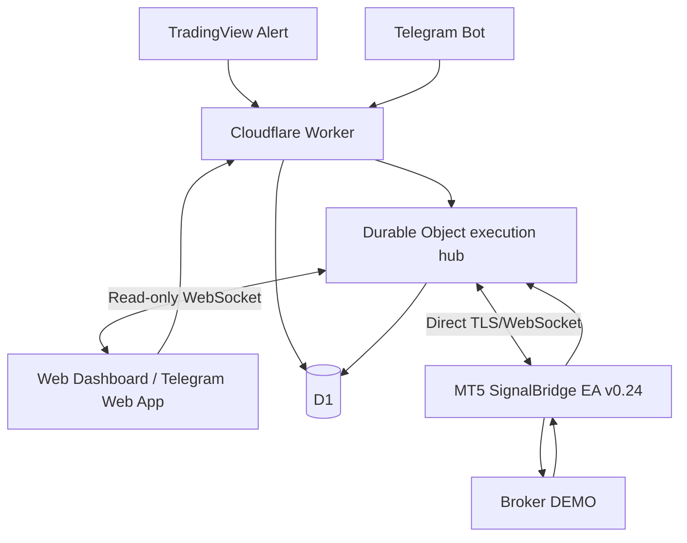

# SignalBridge — V3 Technical Architecture
Version 0.4 · Direct-EA beta · 2026-10-28

## Product rule

The standard installation path is intentionally reduced to:

1. one MetaTrader 5 EA;
2. one private SignalBridge Key inside the EA;
3. one private TradingView webhook URL.

No Node.js, PowerShell or Windows companion Agent is required in the V3 standard flow.

## Production edge

- Worker: `drfx-signalbridge-ingress`
- Custom domain: `signalbridge.drfx.online`
- D1: `signalbridge-ingress`
- Durable Object: `AgentHub` (legacy internal name; now coordinates both direct EA and legacy Agent clients)
- Direct EA WebSocket endpoint: `/v1/ea/ws`
- Legacy Windows Agent endpoint: `/v1/agent/ws`

## Realtime data flow



## Direct EA protocol

The EA establishes an outbound TLS connection to `signalbridge.drfx.online:443`, upgrades it to WebSocket and selects `signalbridge-ea-v1`.

Authentication uses the existing high-entropy execution-connection token. The token is consumed at the Worker boundary; the Durable Object receives only the authenticated connection identity.

The direct EA transport intentionally uses a compact text protocol inside WebSocket frames:

- `HELLO|...`
- `HB|...`
- `PING|...`
- `CMD|...`
- `RCPT|...`
- `RACK|...`

This avoids putting a JSON parser inside the EA while retaining the same durable command lifecycle as the former Windows Agent path.

## Command durability

1. Authenticate source.
2. Validate fail-closed.
3. Persist source event.
4. Create durable command with deterministic correlation tag.
5. Dispatch only to a verified execution socket.
6. Keep undelivered work PENDING.
7. Replay PENDING/DELIVERED only after MT5 account readiness is known.
8. Reconcile broker evidence before accepting a retry as a new order.
9. Keep local pending state until a cloud `RACK` confirms the terminal result was stored.

## TradingView

TradingView posts to:

```text
POST /v1/ingress/tradingview/<private_connection_token>
```

The Worker validates, persists, normalizes and dispatches through the same execution hub.

## Telegram

Telegram Bot updates enter:

```text
POST /v1/ingress/telegram/<connection_id>
```

Bot pairing remains explicit. Telegram Web App is a control/monitoring surface.

The personal-account **MTProto connector is Coming Soon and inactive**. No personal Telegram session is created in the current release.

## Dashboard

The live dashboard remains backend-backed. It observes the execution hub through a read-only observer WebSocket and displays MT5 state, account telemetry, recent commands, cloud RTT and broker receipts.

## Legacy Agent

`agent-windows/` remains for rollback/reference during migration. It is not shown in the standard V3 install flow.

## Current safety boundary

- DEMO execution only.
- Live MT5 account execution remains hard-blocked.
- Broker-side SL and local risk checks stay inside the EA.
- Unknown/ambiguous state fails closed.

## Release gates

Before v0.24 can be called release-certified:

- compile in a real Windows MetaEditor;
- run direct TLS/WebSocket handshake against Production;
- validate reconnect + replay on DEMO;
- validate broker-rejection receipt recovery;
- run end-to-end TradingView → Cloudflare → EA → DEMO broker tests;
- repeat Telegram Bot → EA DEMO tests;
- security review of the direct WebSocket implementation.
