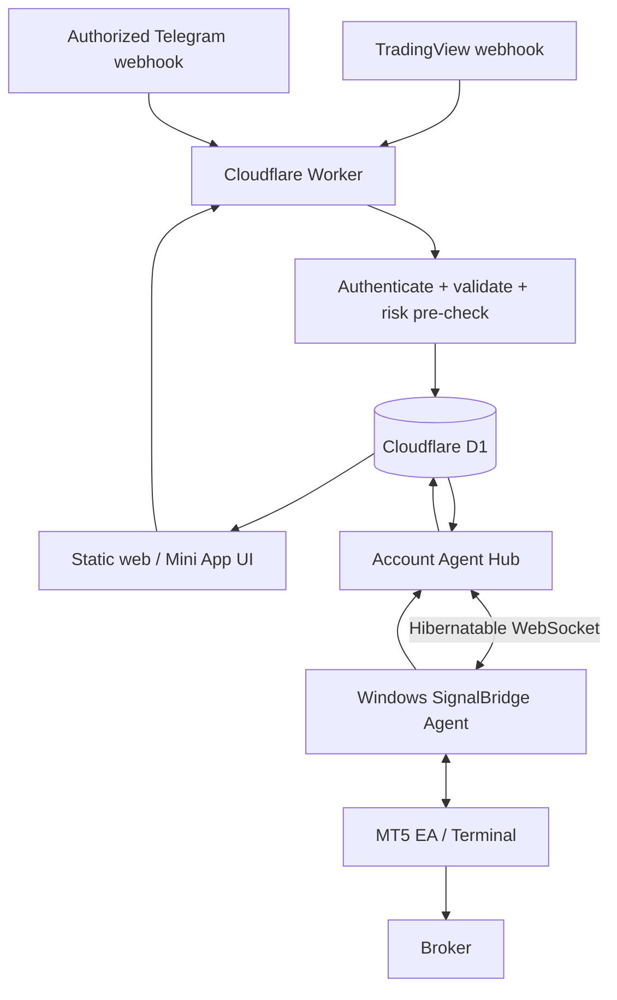
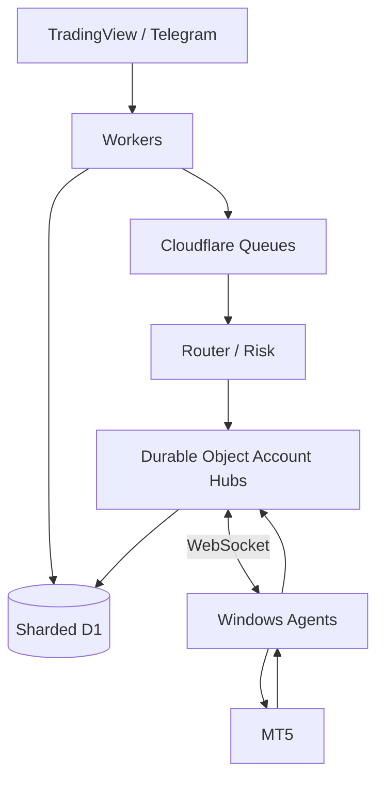

# SignalBridge — Technical Architecture
Version 0.2 · Free-first / scale-ready architecture

## Deployment decision

SignalBridge launches on **Cloudflare Free**. The system must not require a paid Cloudflare feature to serve the first beta users.

The initial target is up to ~500 daily active users under measured usage budgets. Paid migration starts after 500 DAU or earlier when usage thresholds in [CLOUDFLARE_FREE_FIRST.md](CLOUDFLARE_FREE_FIRST.md) are reached, and should complete before routine operation around 1,000 DAU.

## Design constraints

- Cloud edge cannot host a Windows MetaTrader 5 terminal or MQL5 Expert Advisor.
- MT5 execution occurs on an authorized Windows terminal, user VPS, or future managed Windows host.
- HTTP 2xx at webhook ingress means accepted by SignalBridge, **not filled by broker**.
- Every tenant, connection, command and receipt is isolated and auditable.
- The Free launch cannot depend on frequent terminal HTTP polling.
- Queue delivery is at-least-once; future queue consumers still require application idempotency and reconciliation.

## Free launch data flow

## Why realtime delivery is WebSocket-first

A polling architecture does not fit the Free Worker request budget at hundreds of terminals. Five-second polling by 500 terminals would generate millions of requests per day before any TradingView or dashboard traffic.

The scale-ready design therefore uses:
- one authenticated long-lived Agent connection;
- Durable Objects with the WebSocket Hibernation API;
- sparse reconnect/recovery requests;
- HTTP polling only as a recovery fallback.

The Windows Agent is a planned component and is not implemented yet.

## Launch components

1. **Static dashboard** — serve static assets with minimal dynamic API use.
2. **Edge API / ingress** — Cloudflare Worker for TradingView/Telegram ingress, auth and owner-scoped APIs.
3. **Durable store** — D1 for connections, normalized signals, compact command state and receipts.
4. **Realtime Agent Hub** — Durable Object per account or account group, using Hibernatable WebSockets.
5. **Windows Agent** — persistent secure connection to Cloudflare and local coordination with MT5.
6. **MT5 EA** — performs broker-facing checks/execution and reports broker evidence.
7. **Risk/policy engine** — deterministic checks independent of source channel.
8. **Observability** — quota/health/error measurements with redacted diagnostics.

## Free-mode reliability model

The critical path does not require Cloudflare Queues:

1. validate request;
2. persist to D1;
3. return accepted only after durable persistence;
4. signal the Agent Hub when a route/account command is ready;
5. mark undelivered work as pending;
6. reconcile pending work after reconnect or through sparse recovery.

Queues are added after Paid migration for dispatcher/dead-letter scalability.

## Planned paid topology

## Command state machine

RECEIVED → VALIDATED → {REJECTED | APPROVAL_REQUIRED | READY} → DISPATCH_PENDING → DELIVERED → SUBMITTED → {BROKER_REJECTED | FILLED | PARTIAL | UNKNOWN_RECONCILE} → SETTLED.

Only verified terminal/broker evidence may mark FILLED. UNKNOWN_RECONCILE blocks blind resubmission.

## Storage rules

- use tenant-scoped indexed lookups;
- keep the Free-phase event model compact;
- do not update/write telemetry on every UI render;
- unique idempotency constraints protect signal and command creation;
- preserve the minimum evidence required to reconstruct a trade lifecycle;
- move verbose analytics/long retention to later paid infrastructure;
- measure actual D1 rows written per accepted signal before increasing beta limits.

## Risk-critical implementation notes

- Never rely on connection state alone as proof of broker execution.
- Do not blindly retry a submission whose broker outcome is unknown.
- Agent and EA both validate account identity and command revision.
- CLOSE/MODIFY actions require correlation to a known position/order.
- Server-side risk approval does not replace terminal-side broker specification checks.
- Reconnect always reconciles pending/unknown commands before accepting blind replay.

## Environments

Development → Cloudflare Free staging → closed Free beta → Free public beta (within quotas) → Workers Paid production scale.

Live execution remains a separate release gate from infrastructure deployment.

See [CLOUDFLARE_FREE_FIRST.md](CLOUDFLARE_FREE_FIRST.md) for quotas, budget thresholds and migration policy.
