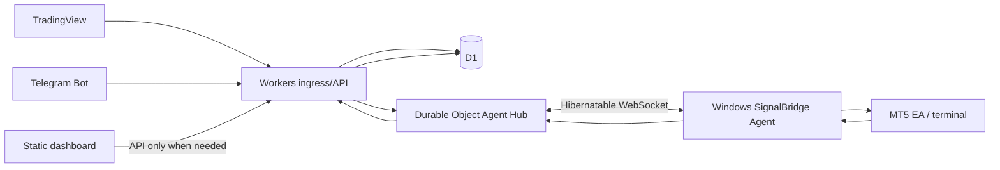

# Cloudflare Free-First Operating Plan

Version: 1.0 · 2026-10-28 · Status: approved launch architecture

## Decision

SignalBridge launches on the **Cloudflare Free plan** and is designed to remain operational there during the early product stage. The paid Workers plan is not required for launch.

The commercial migration trigger is deliberately set **before** the free quotas become a reliability risk:

- **0–350 DAU:** normal Free-plan operation.
- **350–500 DAU:** capacity-watch phase; optimize and load-test continuously.
- **500+ DAU:** begin/prepare the Workers Paid migration.
- **Before reaching ~1,000 DAU:** complete the Paid migration.
- Upgrade earlier whenever real consumption reaches the usage thresholds below, even if DAU is lower.

User count alone is not the capacity metric. Signal frequency, dashboard API traffic, reconnect frequency and D1 write amplification are the actual constraints.

## Current Cloudflare Free-plan limits used by this plan

Revalidate before each release because provider limits can change.

| Resource | Current free allowance relevant to SignalBridge |
| --- | --- |
| Workers requests | 100,000 requests/day |
| Workers HTTP CPU | 10 ms CPU/request |
| D1 rows read | 5,000,000/day |
| D1 rows written | 100,000/day |
| D1 storage | 5 GB total free allocation |
| D1 single database size | up to 10 GB platform limit; free account storage allocation remains lower |
| Durable Objects requests | 100,000/day |
| Durable Objects duration | 13,000 GB-s/day |
| Queues | 10,000 operations/day; not used in the launch critical path |

Official references:
- https://developers.cloudflare.com/workers/platform/limits/
- https://developers.cloudflare.com/workers/platform/pricing/
- https://developers.cloudflare.com/d1/platform/limits/
- https://developers.cloudflare.com/d1/platform/pricing/
- https://developers.cloudflare.com/durable-objects/platform/pricing/
- https://developers.cloudflare.com/durable-objects/best-practices/websockets/
- https://developers.cloudflare.com/queues/

## Free launch topology

### 1. Dashboard
Serve the product UI as static assets. Static asset traffic must not consume the scarce API request budget unnecessarily. Dashboard polling is avoided; use explicit refresh or event-driven updates.

### 2. Worker
One lightweight Worker handles:
- TradingView ingress.
- Telegram webhook ingress.
- authentication and schema validation.
- owner-scoped status/API reads.
- dispatch to the account-specific Agent Hub.

The ingress path remains intentionally small enough for the Free-plan 10 ms CPU budget. Heavy analytics, OCR, LLM parsing and bulk reports do not run synchronously in the trade ingress request.

### 3. D1
D1 is the durable source of truth during the Free launch.

Rules:
- use indexed point lookups rather than table scans;
- keep write amplification small;
- do not create a verbose event row for every UI transition;
- retain compact immutable evidence for trade-critical state;
- archive/delete non-critical verbose diagnostic data according to retention policy;
- measure `rows_read` and `rows_written` from real queries before increasing beta size.

### 4. Real-time MT5 delivery
**Do not poll the Worker every few seconds per terminal.**

At 500 connected terminals, five-second polling would create millions of Worker requests per day and is incompatible with the Free-plan request budget.

The production delivery design is:
- a lightweight Windows **SignalBridge Agent** maintains a secure WebSocket;
- an account-scoped Durable Object acts as the realtime hub;
- use the **WebSocket Hibernation API** so idle sessions can sleep while connections remain open;
- the local Agent communicates with the MT5 EA/terminal;
- HTTP polling is a low-frequency recovery fallback only.

This design is required before claiming 500-user realtime readiness.

### 5. Queues
Cloudflare Queues are deliberately **not** on the per-signal critical path during Free operation because the free allowance is only 10,000 operations/day.

Free-mode reliability uses:
1. persist to D1 first;
2. attempt realtime Agent Hub dispatch;
3. if delivery is uncertain, leave a durable pending state;
4. reconcile from D1 using sparse scheduled/reconnect recovery.

After moving to Workers Paid, Queues can become the standard asynchronous dispatcher/dead-letter layer.

## Operating budgets

Hard platform quotas are not operating targets. SignalBridge keeps reserve capacity for bursts and recovery.

| Metric | Normal target | Warning | Migration/mitigation trigger |
| --- | ---: | ---: | ---: |
| Worker requests/day | <= 50,000 | 60,000 | >= 70,000 sustained |
| D1 rows written/day | <= 50,000 | 60,000 | >= 70,000 sustained |
| D1 rows read/day | <= 2.0M | 2.5M | >= 3.0M sustained |
| Durable Object requests/day | <= 50,000 | 60,000 | >= 70,000 sustained |
| D1 storage | <= 3.0 GB | 3.5 GB | >= 4.0 GB |
| DAU | <= 350 | 350–500 | start Paid migration at >500 |

A single day above a warning threshold is investigated. Three consecutive days at/above a migration threshold trigger Paid migration even if DAU is below 500.

## Capacity model

Example planning case:

- 500 DAU
- 20 accepted trading signals/user/day
- approximately 10,000 new signals/day

The Worker ingress volume is manageable under the 100,000 request/day free cap if dashboard traffic and terminal polling are controlled.

D1 is the tighter constraint. Each logical signal can write multiple physical rows because table/index writes are metered. Therefore the current schema must be measured and optimized before public beta. A design target is **<= 5 D1 rows written per accepted ingress signal** for the intake stage.

At 10,000 signals/day and five metered writes/signal, approximately 50,000 row writes/day are consumed — half of the current free allowance. This leaves space for connection/account state but not unlimited command/event fan-out.

At roughly 1,000 DAU with the same activity, the system can approach the D1 free write ceiling. This is why migration begins after 500 DAU and must complete before the service is routinely operating around 1,000 DAU.

## Product limits while on Free

To preserve reliability:
- beta users may have a configurable per-connection daily signal allowance;
- high-frequency strategies are not promised unlimited alerts;
- non-essential analytics refresh less frequently;
- historical raw payload retention is bounded;
- OCR/LLM parsing is never placed in the synchronous ingress path;
- no permanent per-terminal HTTP polling;
- live-trading enablement remains separate from Cloudflare capacity decisions.

If the free budget is under pressure, protect in this order:
1. authenticated trade ingress;
2. agent command/receipt traffic;
3. security and health endpoints;
4. user dashboard API;
5. analytics and non-critical diagnostics.

Static UI remains separately cacheable/static.

## Migration to Workers Paid

Start migration work when any of these occurs:
- DAU exceeds 500;
- 3-day average exceeds 60–70% of a critical Free quota;
- beta traffic shows predictable burst pressure;
- realtime Agent Hub requires more headroom;
- production support/SLO commitments require paid capacity.

Complete migration before approximately 1,000 active daily users.

Paid-phase changes:
- keep the same Worker API contracts;
- add Cloudflare Queues for asynchronous dispatch/dead-letter handling;
- shard D1 by tenant/account group when measured write concurrency requires it;
- increase observability and retention;
- keep Hibernatable WebSockets for realtime delivery;
- load-test burst scenarios before raising user limits.

The migration is an infrastructure scale change, not a product rewrite.

## Release gates for the Free beta

Before opening to external users:
- deploy a dedicated `drfx-signalbridge-ingress` Worker;
- create a dedicated `signalbridge-ingress` D1 database;
- apply migrations and create non-production connection credentials;
- prove ingress remains inside the 10 ms CPU envelope under fixture load;
- record actual D1 row-read/write amplification;
- implement per-source abuse/rate controls;
- implement Agent Hub + hibernatable WebSocket before realtime MT5 beta;
- build quota dashboards/alerts;
- run a 100-user synthetic load test, then 250, then 500.

No quota estimate substitutes for measured load testing.
