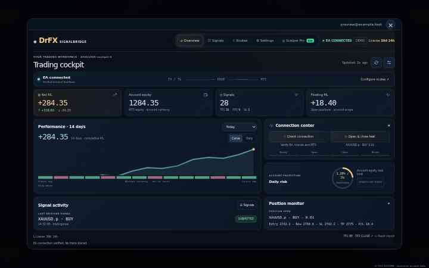
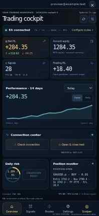

# Member cockpit V3

Release: `20261030-cockpit-3`. Shared by the website account portal and Telegram Mini App.

The overview presents four primary account metrics, cumulative/daily broker history, connection controls, daily risk and the active position together. Desktop also shows the latest received signal separately from the broker-confirmed position. Settings and routing use a native modal with keyboard dismissal and focus management, retaining the existing account, webhook, language and administrator controls.

## Real data and motion

Connection/equity telemetry refreshes every 5 seconds while visible; history/settings retain their separate 10-second cycle. Returning to a visible workspace triggers a refresh. Values animate only when actual telemetry changes. Unknown values remain unknown; failed checks and stale data are labeled. The chart is the EA's 14 daily broker buckets, independent of the selected KPI totals range, and is not an equity curve. Reduced-motion preferences suppress visual effects. Trade confirmation, risk restart and report-reset controls retain their existing backend contracts.

## Validation

- `npm run check`: 253 passing tests, including unique control targets and generated browser runtime syntax.
- Production Worker bundle built with esbuild; `git diff --check` passes.
- Rendered the full website and Mini App with an isolated mock account and no real broker orders or user data. This verified chart rendering, equity values, accessible settings/routing dialogs, console errors and horizontal overflow.

| Surface | Viewport | Overview scroll excess | Horizontal overflow | Runtime errors |
| --- | --- | ---: | --- | --- |
| Website desktop | 1440 × 900 | 0 px | No | None |
| Website tablet | 820 × 1180 | 0 px | No | None |
| Website compact laptop | 1024 × 768 | 2 px | No | None |
| Website mobile | 393 × 851 | 8 px | No | None |
| Telegram web app | 393 × 851 | 0 px body overflow | No | None |

These measurements use a populated test account with a broker position. Smaller screens, translations, enlarged text, open settings and longer live content can require additional scrolling. The desktop/tablet overview includes more context; mobile prioritizes the account and active position, with complete signal history available through Activity/Signals.

Reference renders below are scaled to 50% and show explicitly illustrative test data, not achieved trading returns or a production account.

