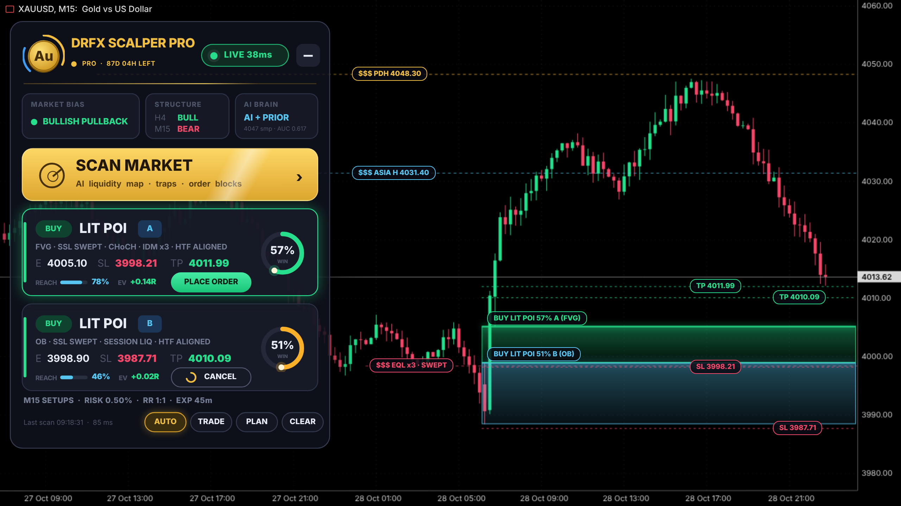
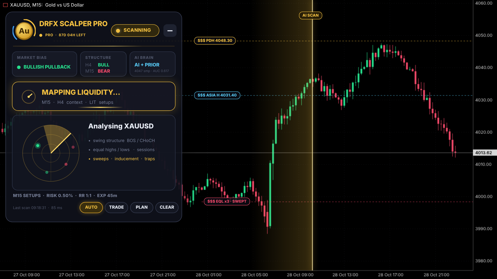
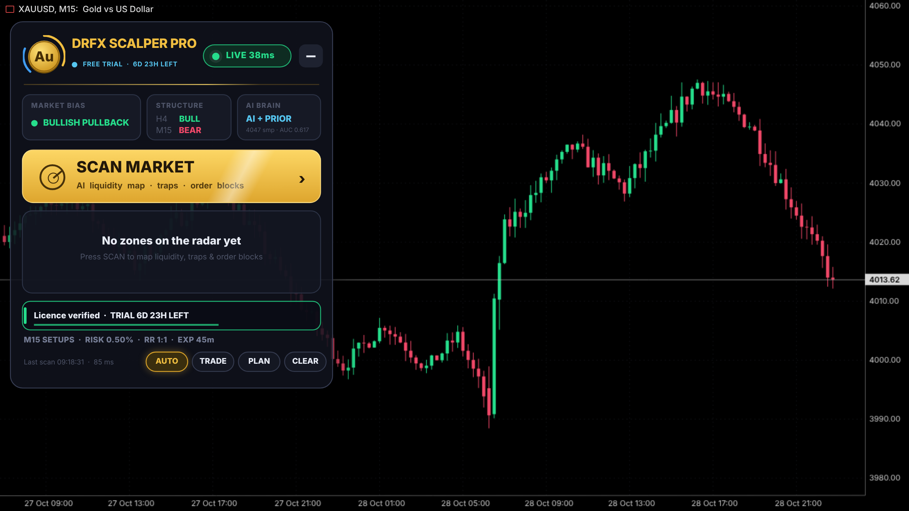
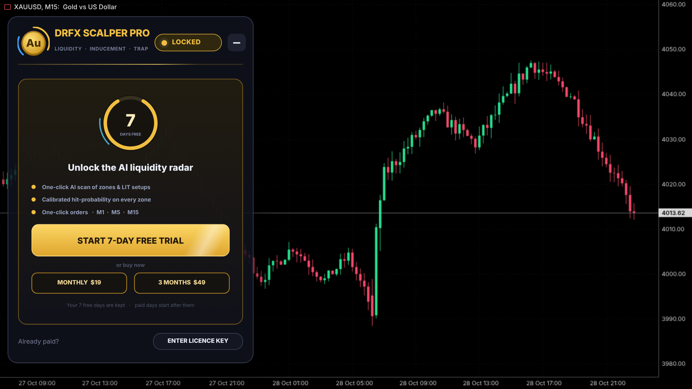
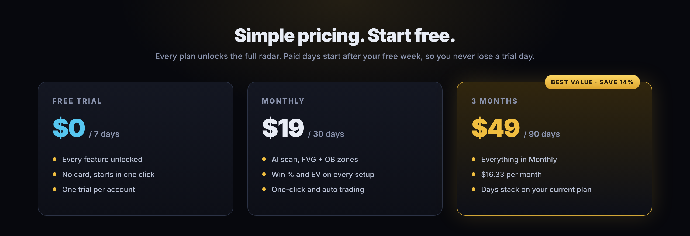

  

<h1 align="center">DrFX Scalper Pro</h1>

<b>The AI liquidity radar for XAUUSD on MetaTrader 5.</b> 
One click maps where smart money hunted liquidity, finds the zone it will defend, and scores how likely price is to respect it.

  
  
  

Scalper Pro is the second product in the DrFX suite, next to SignalBridge. SignalBridge executes the signals you already have; Scalper Pro finds new ones on gold. Both are managed from the same account at [drfx.company](https://drfx.company/) and the DrFX Telegram Mini App.

> The Expert Advisor source code lives in a separate private repository. This folder holds only the public material: promo media, the user guide and the licensing flow.

## Watch it work

[▶ scalper-pro-promo.mp4](scalper-pro-promo.mp4) (25 seconds, 1280×720)

## Why traders use it

Gold rarely moves in straight lines. It sweeps the obvious highs and lows, traps late traders, then runs from a zone most people never marked. Scalper Pro reads that story for you using the LIT (liquidity inducement) method.

- **Finds the sweep.** Equal highs and lows, the Asia range and the previous day's high and low are mapped automatically. A zone only counts if its move first took liquidity.
- **Marks the zone.** It finds the displacement that broke structure (CHoCH or BOS) and draws the Fair Value Gap and Order Block it left behind.
- **Counts the trap.** "IDM x3" means three inducement pivots still sit between price and your zone.
- **Scores every setup.** A model trained on your symbol's own history gives each zone a calibrated win %, a reach % and an expected value in R, graded A+ to C.
- **Trades in one click.** Each card has a limit order with risk-% sizing, a stop beyond the zone, a fixed RR and an automatic expiry. Turn on AUTO and TRADE and it does the same by itself.

| | |
|---|---|
|  |  |
| **Setup cards** with win rings beside the zones they describe. | **AI SCAN** reads structure, liquidity and inducement. |
|  |  |
| **Ready in seconds.** Bias, H4/M15 structure and model quality. | **Start free.** Seven days, every feature, no card. |

Screens are illustrative and show demonstration chart data. Trading involves risk; past model scores do not guarantee future results.

## Plans

| Plan | Price | Access |
|---|---|---|
| Free trial | $0 | 7 days, every feature, once per trading account |
| Monthly | $19 | 30 days |
| 3 months | $49 | 90 days (save 14%) |

Paid days start after any time you have left, so buying during the trial never costs you a free day.

## Buy a licence and get your key

Everything happens in your DrFX account, on the website or in Telegram.

1. Open [drfx.company](https://drfx.company/) and sign in with email or Telegram (top right, **Client Portal**).
2. In the portal open the **Scalper Pro** tab.
3. Enter the **MT5 account number** you will trade on. The key is locked to that account.
4. Pick **Monthly** or **3 Months** and press **Pay with crypto**. You are sent to a secure NOWPayments invoice.
5. When the payment confirms, the key appears in the **Scalper Pro** tab under *My licence keys* and is also sent to you by the DrFX Telegram bot. In Telegram you can see your keys any time with `/scalper`.

Keys look like `DRFX-XXXXX-XXXXX-XXXXX-XXXXX-XXXXX-XXXXX-XXXXX-XXXXX`. They are signed offline, so the EA never needs an internet connection to check them.

## Install

1. Download the EA from the **Scalper Pro** tab of the portal.
2. In MetaTrader 5 open **File → Open Data Folder**, then go to `MQL5/Experts/` and copy `DrFX_Scalper_Pro.ex5` there.
3. Back in MetaTrader, right-click **Expert Advisors** in the Navigator and press **Refresh**.
4. Open an **XAUUSD** chart (M15 works best) and drag **DrFX Scalper Pro** onto it.
5. In the dialog tick **Allow Algo Trading** and press **OK**. Make sure the **Algo Trading** button in the toolbar is green.

## Use

- **First run:** press **START 7-DAY FREE TRIAL** on the panel. Every feature unlocks for 7 days on this trading account.
- **Activate a key:** press **ENTER LICENCE KEY**, paste the key from the portal and press **ACTIVATE**. You can also paste it into the *Licence key* input (F7 on the chart).
- **Scan:** press **AI SCAN**. Setup cards appear with grade, win %, reach % and EV.
- **Trade:** press **BUY LIMIT** / **SELL LIMIT** on a card, or turn on **AUTO** (rescan each candle) and **TRADE** (place the best setup automatically).
- **Plan:** **PLAN** exports an HTML trade plan with the bias, liquidity levels and every setup.
- **Useful inputs:** risk per trade (0.5%), Reward:Risk (1.0), max setups shown (2), setup timeframe (M15), higher timeframe (H4).

One licence runs on one terminal at a time. If you open it on a second terminal, the panel offers to move it there in one click.

## Troubleshooting

| You see | Do this |
|---|---|
| "Licence is for another account" | The key is locked to the MT5 number you entered when buying. Buy a key for this account, or contact support to move it. |
| "Licence expired" | Buy a new period in the portal. Paid days add on top of any time you have left. |
| No orders are placed | Turn on **Algo Trading** in the toolbar and in the EA's Common tab. |
| Panel does not appear | Make sure the chart is XAUUSD and the EA shows a smiling cap icon in the top-right corner. |

Support: Telegram bot `/help` or the Client Portal at [drfx.company](https://drfx.company/).

## For the operator

- Licence keys are minted by the website worker (`site/src/scalper.mjs`) with the same algorithm as the EA. The signing secret is the Cloudflare secret `SCALPER_LICENSE_SECRET` and must equal `DRFX_SECRET` in the private EA build.
- `SCALPER_DOWNLOAD_URL` (optional) is the link members see on the download button.
- Admins can grant keys from the portal's Operations Center (**grant scalper 1m / 3m**) or in Telegram with `/scalperkey MT5_LOGIN 1m|3m [usr_…]`.
- Deployment steps are in [`site/README.md`](../../site/README.md#scalper-pro).
